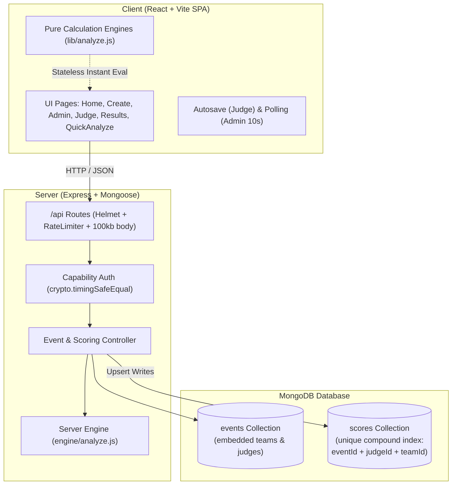

# FairScore

> **Explainable bias-corrected ranking, judge overlap planning, and reliability diagnostics for hackathons and scored events.**

[](https://github.com/Sam-272007/Fair-Score/actions/workflows/ci.yml)
[](https://nodejs.org)

---

## Live Demo

- **Live Application:** [https://fair-score.onrender.com](https://fair-score.onrender.com)
- **Source Repository:** [https://github.com/Sam-272007/Fair-Score](https://github.com/Sam-272007/Fair-Score)
- Demo video: [DEMO_VIDEO_URL_HERE](https://drive.google.com/file/d/1tw3cNQMmXY2K--unSkp_QbUSmhHoK-bc/view?usp=sharing)

**Try it in 30 seconds:**
1. Open the live site at [https://fair-score.onrender.com](https://fair-score.onrender.com).
2. Click **"Create demo event"** on the home page to automatically seed a realistic 12-team, 6-judge hackathon with known scoring bias.
3. Open the organizer dashboard to explore the side-by-side rankings, judge harshness bars, and reliability diagnostics.

> [!NOTE]
> FairScore is hosted on Render's free tier. The free instance spins down during inactivity; if the service is asleep, the first request may take approximately 50-70 seconds (about a minute) to wake up. Once awake, requests respond normally.

---

## 1. Problem Statement

In hackathons, college symposiums, pitch competitions, and capstone project reviews, it is practically impossible for every judge to evaluate every single team. Organizers partition teams among available judges.

When scoring subsets overlap incompletely:
- **Judge Severity Bias:** A harsh judge might score between 5.0 and 7.0, while a lenient judge awards between 8.0 and 9.5.
- **Luck of the Draw:** A stellar team that happens to draw strict judges will receive a lower raw average than a mediocre team evaluated by lenient judges.
- **Hidden Instability:** Organizers have had no automated way to know when an evaluation graph is mathematically disconnected or when a top-3 podium standing hinges precariously on a single judge's opinion.

---

## 2. Target Users

1. **Event Organizers (Primary):** Hackathon leads, university faculty, capstone coordinators, and demo-day hosts who need fair, defensible rankings and overlap planning.
2. **Judges & Evaluators (Secondary):** Industry mentors and academic reviewers who need a frictionless, mobile-first scoring interface without password barriers.

---

## 3. Solution

FairScore provides a complete end-to-end judging workflow application:
1. **Overlap Planning:** Mathematically schedules judge-to-team assignments so that judges overlap with balanced workloads and guaranteed graph connectivity.
2. **Mobile Capability Links:** Generates secure capability links for judges to submit scores with automatic background saving.
3. **Multi-Model Dashboard:** Computes Raw Averages, Z-Scores, and Iterative Judge-Effect Normalization side by side.
4. **Diagnostic Integrity Alerts:** Proactively warns when the evaluation graph is disconnected or when small sample sizes degrade mathematical certainty.
5. **Leave-One-Out Sensitivity Testing:** Tests rank resilience by systematically omitting judges to detect volatile rankings.
6. **Public Results Publication:** Generates an official, public-facing results page with plain-language methodology explanations.

---

## 4. Key Features

- **Three Comparative Methods Side-by-Side:** Raw Arithmetic Mean, Standardized Z-Score Normalization, and Alternating Least-Squares Judge-Effect Model.
- **Zero-Login Capability Auth:** Organizers and judges access events via cryptographic capability URLs without password fatigue.
- **Mobile-First Judge Scoring:** Responsive down to 360px viewport width with debounced per-row autosave, retry handling, and progress feedback.
- **Diverging CSS Judge Harshness Visualizer:** Plain CSS bar charts showing relative judge strictness centered at zero.
- **Bipartite Graph Connectivity Engine:** BFS verification over judge-team scoring pairs with automatic fallback recommendation to Z-scores when disconnected.
- **Podium & Team Stability Panels:** Leave-one-out sensitivity analysis flagging volatile rankings.
- **Stateless Quick Analyze:** Drag-and-drop or paste CSV scoring datasets for instant evaluation with pre-loaded sample datasets.
- **Instant Demo Event Generator:** Creates a populated 12-team, 6-judge demonstration event in one click.

---

## 5. Honest Differentiation

> *Per-judge normalization already exists in some paid judging platforms. FairScore is free, explains the correction, plans judge overlap, and warns when the data cannot support a reliable correction.*

---

## 6. Tech Stack

- **Runtime & Architecture:** Node.js 20+ (ES Modules throughout).
- **Frontend:** React 19, Vite 6, React Router 7, PapaParse.
- **Styling:** Handcrafted CSS with CSS variables, responsive design, focus accessibility, and plain CSS charts (no heavy UI frameworks).
- **Backend:** Express 4, Mongoose 8, Zod, Helmet, Express Rate Limit, Dotenv.
- **Testing:** Node.js built-in `node:test` runner, Vitest for frontend calculation engines, Supertest, and MongoMemoryServer for in-memory integration testing.
- **Database:** MongoDB Atlas (M0 Free Tier) with compound uniqueness constraints.

---

## 7. Architecture

### System Architecture Diagram



### Authentication Design

FairScore deliberately uses an accountless, capability-based security model rather than traditional usernames and passwords:
- **Capability Tokens:** Unguessable cryptographically random tokens generated using `crypto.randomBytes(24).toString('base64url')`.
- **Organizer Admin Link:** Formatted as `/admin/:eventId#t=<token>`.
  - The secret token resides entirely in the URL hash fragment (`#t=...`), which web browsers **never transmit to the server** in HTTP requests.
  - The client reads the fragment and sends it in the `Authorization: Bearer <token>` header.
  - The server stores only the **SHA-256 hash** of the admin token and verifies incoming requests using constant-time `crypto.timingSafeEqual` to eliminate timing side-channel attacks.
  - Admin links are cached in local browser storage (`localStorage`) under "My Events".
- **Judge Links:** Formatted as `/judge/:token`. Judge tokens are stored raw so organizers can re-copy and distribute links. Each judge can only view and score their assigned teams.
- **Security Trade-off:** There are no user accounts, passwords, or email resets by design. Anyone possessing a capability link holds that authorization (organizer admin or specific judge access), so capability links must be kept private.
- **Idempotent Upserts:** Scores use a compound unique index on `(eventId, judgeId, teamId)` to ensure re-submissions update rather than duplicate.

---

## 8. Local Setup

### Prerequisites
- Node.js 20.x or higher
- npm 10.x or higher

### Installation

```bash
# 1. Clone the repository
git clone https://github.com/Sam-272007/Fair-Score.git
cd Fair-Score

# 2. Install dependencies across root, server, and client packages
npm install
npm --prefix client install
npm --prefix server install

# 3. Create environment configuration
cp .env.example .env
```

### Running Locally

```bash
# Development mode (runs Vite client on :5173 with proxy to Express server on :5000)
npm run dev

# Production build and run
npm run build
npm start
```
Open your browser at `http://localhost:5000`.

---

## 9. Environment Variables

Configure your `.env` file (copied from `.env.example`):

| Variable | Description | Default |
| :--- | :--- | :--- |
| `PORT` | HTTP server port | `5000` |
| `NODE_ENV` | Application environment (`development`, `production`, `test`) | `development` |
| `MONGODB_URI` | MongoDB Atlas or local connection string | *Optional in dev/test* |

---

## 10. Testing

FairScore includes comprehensive automated tests (56 passing tests total) across calculation engines, API endpoints, reverse-proxy integration, floating-point decimal precision, and graph simulations:

- **Client Tests (Vitest):** 19 tests in `client/tests/engine.test.js` covering CSV parsing, score validation, raw averaging, z-scores, judge-effect model convergence, bipartite connectivity, ranking ties, assignment planner balance, and seeded Monte Carlo simulation.
- **Server API Tests (`node:test` + Supertest):** 7 integration tests in `server/tests/api.test.js` using in-memory MongoDB verifying health checks, event creation, capability auth, invalid status transitions, judge scoring bounds, unassigned/locked scoring rejection, upsert idempotency, and public results visibility.
- **Decimal Precision Tests (`node:test`):** 20 tests in `server/tests/decimal.test.js` verifying shared score validation across valid decimal values (e.g. 8.5, 7.25, 6.1, 9.7, 0.1+0.2) and robust 400 rejection for invalid inputs (>2 decimals, out of range, non-numeric).
- **Reverse-Proxy & Rate-Limiting Tests (`node:test`):** 3 tests in `server/tests/ratelimit.test.js` verifying proxy IP resolution under single-hop reverse proxies, client IP isolation, demo event rate limits (20/hr), and standardized `{error:{code:'RATE_LIMITED', message:'...'}}` responses.
- **Server Engine Tests (`node:test`):** 7 unit tests in `server/tests/engine.test.js` verifying server-side engine parity, zero-variance handling, and sample datasets.

```bash
# Run all tests across client and server (56 tests)
npm test

# Run client calculation engine tests with Vitest (19 tests)
npm run test:client

# Run server node:test integration, decimal, ratelimit, and engine suites (37 tests)
npm run test:server

# Run the 10-step end-to-end smoke test suite
npm run smoke
```

### Smoke Test Output Sample
```text
======================================================
🚀 Starting FairScore End-to-End Smoke Test
🎯 Target Base URL: http://localhost:5000
======================================================

[PASS] Step 1: Health Check (/api/health) (HTTP 200, DB: connected)
[PASS] Step 2: Create Event (POST /api/events) (Event ID: 6ae1d77b43cccdebb4b1761e)
[PASS] Step 3: Open Scoring (setup -> scoring) 
[PASS] Step 4: Submit Judge Scores (PUT /api/judge/:token/scores/:teamId) (9 scores recorded)
[PASS] Step 5: Admin Dashboard & Analysis (GET /api/admin/:id) (Model Winner: Team Pegasus)
[PASS] Step 6: Lock Event (scoring -> locked) 
[PASS] Step 7: Results Hidden Until Published (GET /api/results/:id -> 404) (HTTP 404)
[PASS] Step 8: Publish Event (locked -> published) 
[PASS] Step 9: Fetch Public Results (GET /api/results/:id -> 200) (1st place: Team Pegasus)
[PASS] Step 10: Stateless Quick Analyze (POST /api/analyze) (Teams: 2)

======================================================
📊 Smoke Test Summary: 10 / 10 passed
======================================================

✅ ALL SMOKE TEST STEPS PASSED SUCCESSFULLY!
```

---

## 11. Deployment

FairScore is live in production at: **[https://fair-score.onrender.com](https://fair-score.onrender.com)**.

See [DEPLOY.md](DEPLOY.md) for detailed configuration options.

### Live Deployment Instructions:
1. **Database:** Deploy a free **MongoDB Atlas M0** cluster and whitelist network access (`0.0.0.0/0`). Create a database user and obtain the connection string:
   ```text
   mongodb+srv://<username>:<password>@cluster0.example.mongodb.net/fairscore?retryWrites=true&w=majority
   ```
2. **Web Service:** In [Render](https://dashboard.render.com/), create a new **Web Service** connected to your repository (`main` branch).
3. **Build Command:**
   ```bash
   npm install --include=dev && npm --prefix client install --include=dev && npm --prefix server install --include=dev && npm run build
   ```
4. **Start Command:**
   ```bash
   npm start
   ```
5. **Environment Variables:** Set `NODE_ENV=production` and `MONGODB_URI=<your-atlas-uri>`. Set the Health Check Path to `/api/health`.
6. **Live Verification:** Run the automated end-to-end smoke test against the live endpoint:
   ```bash
   BASE_URL=https://fair-score.onrender.com npm run smoke
   ```

---

## 12. Limitations & Honest Notes

- **Requires Judge Overlap:** The additive judge-effect model requires overlapping judges between teams. If an event has disconnected judging groups with no shared judges, mathematical cross-calibration is impossible. In this scenario, FairScore warns the organizer and falls back to Z-score normalization.
- **Small Sample Variability:** If a judge scores fewer than 3 teams, estimates of their personal strictness or variance are noisy. FairScore flags low sample sizes with diagnostic warnings.
- **Additive Assumption:** The model assumes an additive relationship: $\text{Score} = \text{Quality} + \text{Bias} + \text{Noise}$. It does not model non-linear judge behavior or criteria interactions.
- **Supports, Does Not Replace, Human Decisions:** FairScore is a quantitative decision-support tool. It provides visibility into scoring anomalies and rank shifts to assist organizers, committee chairs, and judges in making fair and transparent decisions.
- **Floating-Point Representation:** JavaScript IEEE-754 numbers can produce floating-point precision artifacts (e.g. `0.1 + 0.2 = 0.30000000000000004`). Scores are validated with a shared tolerance helper (`validateAndRoundScore`) and rounded to 2 decimal places before transmission and database storage.
- **Rate Limiting & Proxy Configuration:** Express rate limiters protect the API (300 req/15min general, 120 req/min for general writes, and a dedicated 20 req/hour limit for demo event generation). In production, `trust proxy: 1` is configured for single-hop TLS terminators like Render.
- **Single-Origin Deployment:** Express serves the built React SPA directly from `client/dist`. Deploying client and server on separate domains requires custom CORS and reverse proxy configuration.

---

## 13. AI Usage

AI coding assistants (**Google Antigravity** and **GitHub Copilot**) were used during development following a detailed written build specification ([docs/BUILD_SPEC.md](docs/BUILD_SPEC.md)).
- **No AI in Product:** The application contains **zero AI or LLM runtime calls**. All ranking, normalization, graph connectivity, and sensitivity calculations are deterministic statistical and graph algorithms executed entirely in JavaScript.
- **Author Ownership:** The architecture, code, test suites, and deployment were reviewed, tested, and deployed by the author. The full specification and prompts are preserved in [docs/BUILD_SPEC.md](docs/BUILD_SPEC.md) for transparency.

---

## 14. Credits & Libraries

- **Express**: Lightweight web server and middleware routing.
- **Mongoose**: MongoDB object modeling and validation.
- **Zod**: Declarative runtime schema validation.
- **Helmet**: Essential HTTP security headers.
- **Express Rate Limit**: API abuse protection and write rate limiting.
- **React & Vite**: Modern reactive UI and bundle pipeline.
- **PapaParse**: Reliable client-side CSV parsing.
- **Vitest & Node:Test**: Modern testing frameworks.
- **Supertest & MongoMemoryServer**: Zero-setup integration testing.
